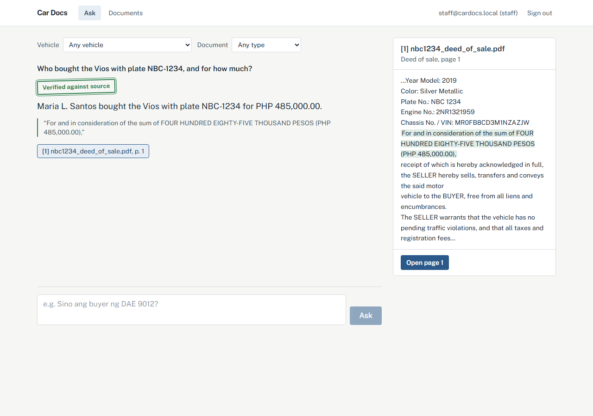
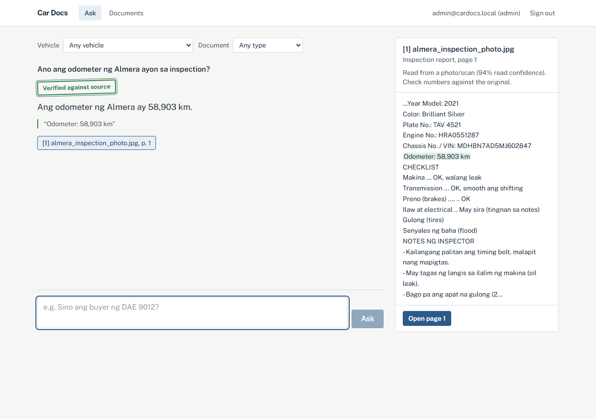
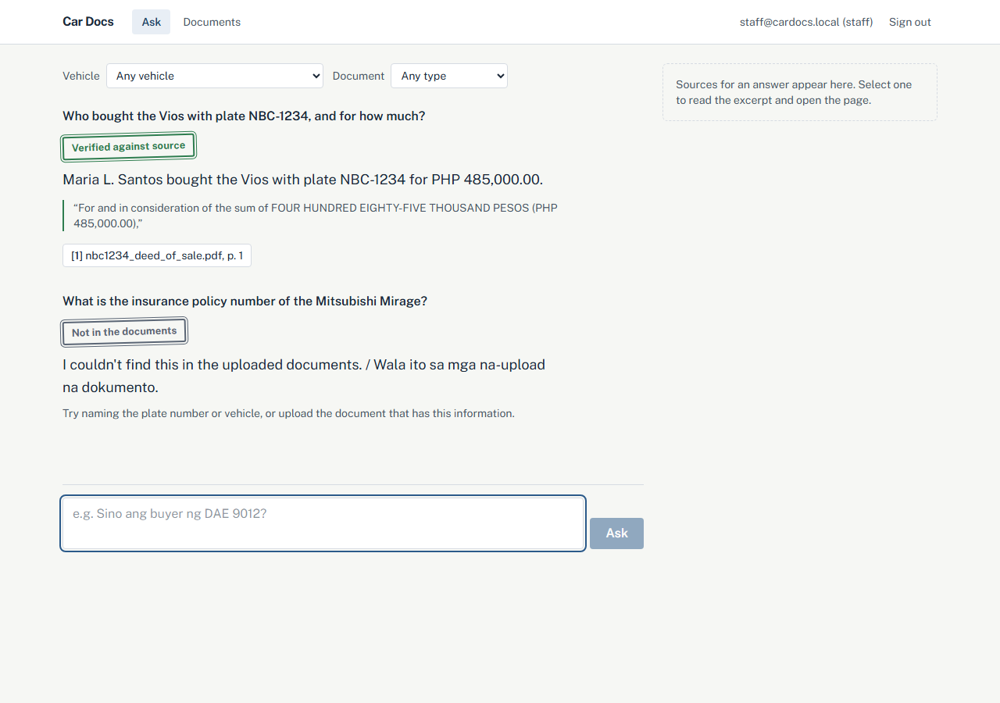
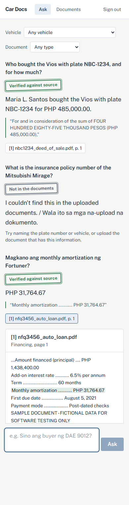
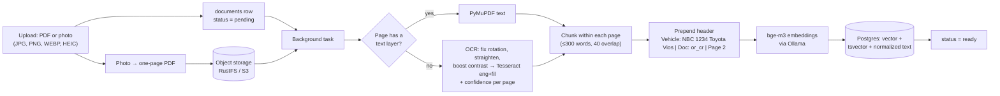
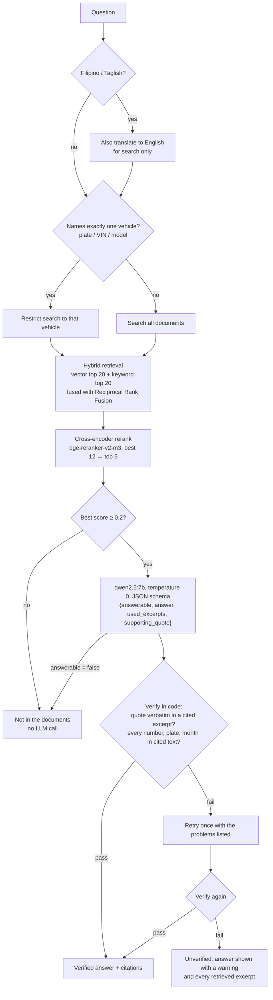

# DocuKotse: grounded Q&A over dealership paperwork

Car dealers in the Philippines handle a stack of paperwork for every vehicle: OR/CR, deed of
sale, insurance policy, inspection report, loan papers. DocuKotse lets staff upload those
papers, as PDFs or as phone photos and scans (read with OCR), and ask questions in English,
Filipino or Taglish ("Magkano ang monthly amortization ng Fortuner?"). Every answer cites the
exact file and page. When the documents don't say, the app refuses instead of guessing, and
it checks every answer against its source in code before showing it as verified. It runs
locally: Postgres + pgvector, S3-compatible object storage (RustFS), and open models on Ollama.



| Answer from a phone photo (OCR) | Not in the documents | On a phone |
|---|---|---|
|  |  |  |

All names, plates, VINs and companies in the sample data are fictional (see
[Data privacy](#limitations-and-next-steps)).

## Contents

- [How it works](#how-it-works)
- [The reliability layer](#the-reliability-layer)
- [Evaluation](#evaluation)
- [Run it](#run-it)
- [Tech stack and why](#tech-stack-and-why)
- [Project layout](#project-layout)
- [Limitations and next steps](#limitations-and-next-steps)

## How it works

### Ingestion (background task after upload)



Photos are stored as one-page PDFs, so the same pipeline, page citations and "open page"
viewer work for every upload. Pages without a text layer (photos, scanned PDFs) are read with
Tesseract after automatic clean-up: 90/180/270° rotation from Tesseract's orientation
detection, straightening of tilted pages (projection-profile skew search that ignores the
desk around a photographed page), denoising and local contrast boost.

LTO forms need more than that. An OR/CR is a grid of boxed values on a blue security pattern;
read like a letter, it gives the labels ("PLATE NO.") but not the values. When a page has a
ruled grid, each box is read on its own with a local black/white threshold, producing lines
like `ENGINE NO.: HKD40527`, so a value stays tied to its label. Further passes pick up text
outside the boxes and re-read regions tilted differently from the rest of the page (curled
paper). A line from an extra pass is kept only if it adds something new, which drops
security-pattern noise and garbled copies of known values. On one real CR photo this went from
3 to all 14 checked values, and 17 test questions about it are answered correctly and verified.

The OCR confidence is stored per page and shown in the UI, and **Re-read** on the Documents
page runs a stored file through the current pipeline. Chunks never cross page boundaries, so
every citation points to a real page. Re-ingesting a document replaces its chunks. Failures
are stored on the document and shown in the UI.

### Answering a question



## The reliability layer

A wrong answer about a registration, a deed or a loan balance is worse than no answer, so
each layer below exists to catch a specific failure seen during development.

| Layer | What it catches | Where |
|---|---|---|
| **Hybrid search** | Plates, VINs and receipt numbers are exact strings that embeddings blur and Postgres full-text splits. A third signal matches them against a normalized copy of the text, where `NBC 1234`, `NBC-1234` and `nbc1234` are equal. | [retrieval.py](backend/app/services/retrieval.py) |
| **Cross-encoder reranking** | Cosine similarity is too flat to judge relevance: the top score for a question with *no* answer (0.56) matched those for answerable ones. The reranker separates them (0.03 vs 0.4–0.99). | [cross_encoder.py](backend/app/services/providers/cross_encoder.py) |
| **Abstain threshold** | If the best reranked chunk scores below 0.2, the app says "not in the documents" without calling the LLM. | [generation.py](backend/app/services/generation.py) |
| **Vehicle scoping** | A quote from another car's document passes the quote checks (the *Vios's* policy number given for the Mirage). When a question names exactly one vehicle, retrieval is limited to that vehicle's documents. | `resolve_vehicle` in [retrieval.py](backend/app/services/retrieval.py) |
| **Taglish translation for search** | The reranker scores Taglish questions poorly against English documents (0.01 vs 0.43 for the same question in English). They are also translated for search and each page keeps its best score; the model still answers the original question. | `translate_to_english` in [generation.py](backend/app/services/generation.py) |
| **Identifier-aware abstain threshold** | The reranker underrates terse form text, so a question about `ENGINE NO.: HKD40527` scored 0.196 and was refused. When the top chunk contains the plate, VIN or receipt number asked about, the bar drops to 0.05 and the LLM plus verification decide. | `answer_question` in [generation.py](backend/app/services/generation.py) |
| **Evidence-first answers** | The model fills its JSON in field order, and with `answerable` first it decided before reading closely. Ordering the schema quote → answer → answerable took chassis and VIN questions from 4/5 to 5/5, and a refusal that quotes real evidence is asked once more. | `ANSWER_SCHEMA` in [generation.py](backend/app/services/generation.py) |
| **Buyers only from a deed of sale** | The model sometimes gave an OR/CR's registered owner as the buyer, and prompt rules didn't stop it. An answer to a who-bought question must cite a deed of sale, or the app says it isn't in the documents. | `buyer_answer_has_deed` in [answer_checks.py](backend/app/services/answer_checks.py) |
| **Identifiers must be in the quote** | An engine number quoted from a chassis line ending in it used to pass. Any code mixing letters and digits in the answer must be a whole token in the quote, unless the user typed it; quotes may list several lines separated by " \| " for multi-part answers. | [verification.py](backend/app/services/verification.py) |
| **Quotes that only repeat the question** | For "what car is XYZ7788?" the model could quote `PLATE NO.: XYZ7788` and answer nothing useful. When every quoted value is already in the question, it is asked again from scratch with a hint to quote the lines that answer it. | `only_restates_question` in [answer_checks.py](backend/app/services/answer_checks.py) |
| **"How much" needs an amount** | "When was the OR paid and how much?" was sometimes answered with the date only, even at temperature 0. A "how much"/"magkano" answer without a peso amount fails verification and is retried. | `check_answer` in [answer_checks.py](backend/app/services/answer_checks.py) |
| **Registration status from an expiry date only** | The model took form text ("is duly registered") and issue dates as proof of validity. If none of the vehicle's OR/CR documents has a "valid until" line the app says so without asking the model; otherwise an answer claiming an expiry must quote an expiry line. | `registration_without_expiry` in [answer_checks.py](backend/app/services/answer_checks.py) |
| **Follow-up questions keep the vehicle** | A follow-up like "who owns it?" names no vehicle, so the search found nothing. The vehicle from the latest earlier question that named one is added ("who owns it? (about XYZ7788)"); the conversation stores the question as typed. | `with_conversation_vehicle` in [generation.py](backend/app/services/generation.py) |
| **OCR confidence in the UI** | OCR can misread a digit at high confidence, and verification can't catch that because the wrong digit is in the source text. Every citation read from a photo says so and asks staff to check numbers against the original, more strongly below 70% confidence. | [ocr.py](backend/app/services/ocr.py), source panel in the UI |
| **Structured output + verification** | The model returns JSON with a supporting quote; code checks that the quote is verbatim in a cited excerpt and that every number, plate and month in the answer is in the cited text. On failure it retries once, then shows the answer marked **unverified** with all retrieved excerpts. | [verification.py](backend/app/services/verification.py) |

## Evaluation

**Method.** [eval/dataset.jsonl](eval/dataset.jsonl) has 37 questions over the 19 sample
documents:

- 22 answerable questions about clean PDFs (6 in Taglish/Filipino, several with identifiers
  written differently from the document, like `abc5678` or `DAE-9012`);
- 7 answerable questions about papers that exist **only as phone photos or a scan** (a
  tilted CR photo, a sideways dim OR photo, a skewed image-only deed of sale), including one
  where OCR misreads the answer on one of the pages;
- 8 unanswerable questions of the dangerous kind: each asks about a document that doesn't
  exist *for that vehicle* (the Mirage's insurance, the Honda City's deed of sale) while a
  similar document exists for another car.

[eval/run_eval.py](eval/run_eval.py) runs every question through the real pipeline
(bge-m3, bge-reranker-v2-m3, qwen2.5:7b on an RTX 4060, documents ingested with OCR inside
Docker) once per configuration, against a freshly seeded database.

- **Hit@5**: a page containing the answer is among the 5 chunks given to the model.
- **Answer accuracy**: the answer contains the expected facts (keyword match).
- **Photo/scan accuracy**: the same, for the 7 questions answered from photos and scans.
- **Abstention accuracy**: unanswerable questions answered with "not in the documents".
- **Faithfulness**: answers whose quote and numbers are found in the cited text (the
  verifier used as a measuring tool, for every configuration).
- **Confidently wrong**: share of all 37 questions where the user sees a wrong or invented
  answer *without* a warning. This is the number that matters for a dealership.

| Configuration | Hit@5 | Answer accuracy | Taglish accuracy | Photo/scan accuracy | Abstention accuracy | False abstain | Faithfulness | Confidently wrong | p50 / p95 latency |
|---|---|---|---|---|---|---|---|---|---|
| Vector only | 100.0% | 96.6% | 85.7% | 85.7% | 37.5% | 3.4% | 97.0% | 13.5% | 7.78s / 8.84s |
| Hybrid (vector + keyword, RRF) | 100.0% | 96.6% | 85.7% | 85.7% | 37.5% | 3.4% | 93.9% | 13.5% | 7.63s / 9.5s |
| Hybrid + rerank + abstain | 100.0% | 96.6% | 85.7% | 85.7% | 100.0% | 3.4% | 100.0% | 0.0% | 7.79s / 9.34s |
| + verification | 100.0% | 96.6% | 85.7% | 85.7% | 100.0% | 3.4% | 100.0% | 0.0% | 7.59s / 8.87s |
| + vehicle scoping + Taglish translation (full system) | 100.0% | 100.0% | 100.0% | 100.0% | 100.0% | 0.0% | 100.0% | 0.0% | 7.79s / 12.1s |
| llama3.2:3b, everything except verification | 100.0% | 96.6% | 100.0% | 100.0% | 100.0% | 0.0% | 72.4% | 2.7% | 6.09s / 9.11s |
| llama3.2:3b, full system | 100.0% | 86.2% | 71.4% | 100.0% | 87.5% | 13.8% | 88.5% | 2.7% | 6.1s / 12.01s |

Per-question results are in [eval/results/](eval/results/).

**What the numbers say**
- **Reranking plus the abstain threshold does most of the work.** Without them, the model
  answers 4–5 of the 8 trap questions with another car's facts. The cross-encoder scores six
  of the eight 0.002–0.11, so they are refused without calling the LLM; the other two reach
  the model, which declines them. Confidently wrong: 13.5% → 0%.
- **Hybrid search alone doesn't change abstention here.** Keyword matches on plates and doc
  types pull in documents from neighbouring vehicles. It pays off once the reranker filters
  candidates.
- **Photos and scans work, but OCR can misread.** With the full system every photo/scan
  question is answered correctly. The first OCR version read "Year Model: 2021" as "2024", and
  verification can't catch that, so every answer sourced from a photo is labelled in the UI.
- **Taglish translation fixed the last Taglish failure.** Taglish accuracy 85.7% → 100%, for
  about 1 s extra on Taglish questions only.
- **Verification is a safety net whose value depends on the model.** With qwen2.5:7b every
  answer in the full system is both correct and verified. With llama3.2:3b it brings
  faithfulness from 72% to 89% (misspelled names, a misread price) at the cost of more
  refusals (false abstain 0% → 13.8%). It isn't enough on its own for a 3B model: a real number
  quoted from the wrong document passes every check. That trade is deliberate: a refusal costs
  a staff member a minute; a wrong amount on a deed costs much more.
- **Hit@5 is 100% everywhere.** With 19 documents, retrieval is easy. A bigger corpus is
  needed to separate the retrieval methods; the abstention, verification and photo results
  are the meaningful part of this table.

**Changes made because of the eval** (all covered by tests): a prompt rule that an OR/CR owner
is not a buyer; treating a refusal written as an answer as "not answerable";
punctuation-insensitive quote matching; a 512-token cap and a 503 response when the LLM stalls;
projection-profile deskew; Taglish query translation. A real CR photo then led to box-by-box
form reading, OCR noise filtering and the curled-paper pass, plus the later rows of the table
above.

The threshold was chosen from the score gap on this same set, and the set is small, so treat
these as relative comparisons between configurations rather than production accuracy.

## Run it

**Prerequisites:** Docker Desktop (WSL2 on Windows), and [Ollama](https://ollama.com) on the
host with the models pulled:

```sh
ollama pull bge-m3
ollama pull qwen2.5:7b-instruct
```

```sh
git clone <this repo> docukotse && cd docukotse
cp .env.example .env                               # change the secrets
docker compose -f docker-compose.yml -f docker-compose.gpu.yml up -d --build   # NVIDIA GPU
docker compose exec api python scripts/seed.py    # demo users, 7 vehicles, 19 documents
```

Without an NVIDIA GPU, use the base file alone and build the smaller CPU image:

```sh
TORCH_INDEX=https://download.pytorch.org/whl/cpu docker compose up -d --build
```

- App: http://localhost:3000, signed in as `staff@cardocs.local` / `staff123` (or
  `admin@cardocs.local` / `admin123`, who can also delete documents)
- API docs: http://localhost:8000/docs
- Object storage console (RustFS): http://localhost:9001

Ollama runs on the host so it can use the GPU; the API container reaches it at
`host.docker.internal`. The reranker runs inside the API container;
[docker-compose.gpu.yml](docker-compose.gpu.yml) gives it the NVIDIA GPU (this needs Docker
Desktop with WSL 2, or the NVIDIA Container Toolkit on Linux). Without it, answers take 15–30 s.
The API loads all three models when it starts, so the first question doesn't wait for them.
The reranker downloads about 2 GB the first time.

Measured on an RTX 4060 (8 GB), qwen2.5:7b, per question:

| Step | Reranker on CPU | Reranker on GPU (fp16, top 12) |
|---|---|---|
| Rerank | 14–28 s | 0.2–0.9 s |
| Whole answer | 15–30 s | 3.5–6 s |
| First question after a restart | ~60 s (models loading) | 3.5 s (loaded at startup) |

### Without Docker (development)

```sh
cd backend
python -m venv .venv && .venv/Scripts/pip install -r requirements-dev.txt   # bin/ on macOS/Linux
# Needs Postgres 16 with pgvector and an S3-compatible store; set DATABASE_URL / S3_* to match.
.venv/Scripts/alembic upgrade head
.venv/Scripts/python ../scripts/seed.py
.venv/Scripts/uvicorn app.main:app --reload

cd ../frontend && npm install && npm run dev
```

### Tests

| Suite | Command | Needs |
|---|---|---|
| Backend: chunking, auth, vehicles, ingestion, retrieval, verification, chat, OCR (171 tests) | `cd backend && pytest` | Postgres with pgvector. Storage, embeddings, reranker and LLM are faked; 6 OCR tests also need Tesseract and are skipped without it. |
| Frontend: answer states, citations, photo uploads, OCR warnings, desktop and mobile (14 tests) | `cd frontend && npm run build && npm run test:e2e` | Nothing; the API is mocked |
| Evaluation | `python eval/run_eval.py` | The seeded stack with Ollama |

GitHub Actions runs lint and both test suites on every push ([ci.yml](.github/workflows/ci.yml)),
and a smoke test that builds the images, runs `docker compose up` and checks login, upload,
signed downloads and the frontend from outside the containers
([compose.yml](.github/workflows/compose.yml)). A second job in that workflow runs Ollama
as a container on CPU with qwen2.5:3b and checks the whole pipeline inside Docker: all
sample PDFs ingest, an answerable question gets a cited answer, and an unanswerable one is
refused.

## Tech stack and why

| Layer | Choice | Why |
|---|---|---|
| API | FastAPI, SQLAlchemy 2, Alembic, Pydantic v2 | Typed request/response models, auto docs, plain sync SQL that's easy to read |
| Database | PostgreSQL 16 + pgvector | One database for relational data, vectors (HNSW) and full-text (GIN), so hybrid search is a couple of SQL queries rather than a second service |
| Files | RustFS via boto3 | S3-compatible, so the same code works on AWS S3 or MinIO. RustFS replaces MinIO in Docker because MinIO stopped publishing images. Downloads use short-lived signed URLs |
| Background work | FastAPI `BackgroundTasks` | Uploads return immediately; a job queue (Redis + ARQ) is the next step once ingestion needs retries or multiple workers |
| Embeddings | `bge-m3` (1024-dim) via Ollama | Multilingual, handles Taglish; small enough to share an 8 GB GPU with the LLM |
| OCR | Tesseract 5 (English + Filipino) with OpenCV clean-up | Free and local, has Filipino language data, installed inside the Docker image. Photos (incl. iPhone HEIC) become one-page PDFs |
| Reranker | `BAAI/bge-reranker-v2-m3` | Multilingual cross-encoder; gives a usable confidence score for abstaining |
| LLM | `qwen2.5:7b-instruct` via Ollama | Fits in 8 GB VRAM at 4-bit; supports JSON-schema constrained output |
| Frontend | Next.js (App Router), TypeScript, Tailwind | Client components calling the API; Playwright tests with a mocked backend |

Every model sits behind a small interface (`Embedder`, `LLMProvider`, `Reranker` in
[providers/base.py](backend/app/services/providers/base.py)), so swapping a model is a config
change. The evaluation compares two LLMs that way.

## Project layout

```
backend/app/
  api/            auth, vehicles, documents, chat endpoints
  services/       chunking, ingestion, ocr, retrieval, generation, answer_checks, verification, storage
  services/providers/   Ollama embedder + LLM, cross-encoder reranker
  db/             SQLAlchemy models (Alembic migrations in backend/alembic/)
backend/tests/    pytest suites
frontend/         Next.js app (app/, components/, lib/, e2e/)
eval/             dataset.jsonl, run_eval.py, results/
scripts/          make_sample_docs.py (fictional PDFs), seed.py
samples/          generated sample PDFs + manifest.json
```

## Limitations and next steps

**Known limitations**
- **OCR reads print, not handwriting.** Printed forms, receipts and typed deeds read well
  (84–95% confidence on the sample photos and scans; all 14 checked values on a real LTO CR
  photo); stylized fonts and badly curled paper are the weak spots. Several photos of one
  document are stored as separate documents.
- **Limited follow-ups.** A follow-up keeps the vehicle from earlier in the conversation, but
  is otherwise answered on its own: "and the price?" doesn't use the earlier question.
- **Small evaluation set.** 37 questions over 19 documents shows the relative effect of each
  layer, but not production accuracy. The abstain threshold was chosen from the score gap
  on this set, not on held-out data.
- **Verification checks grounding, not meaning.** It proves the quote and the numbers come
  from the cited text, not that the answer reads them correctly (e.g. remaining *balance*
  vs remaining *months*).
- **JWT in localStorage.** Fine for a demo; production should use an httpOnly cookie.

**Data privacy (RA 10173, Data Privacy Act of 2012).** The real documents contain personal
data (names, addresses, government IDs, loan details). Before using real documents:
role-based access per branch or deal, encryption at rest for Postgres and the object store,
an audit log of who viewed or asked about which document, a retention and deletion policy,
and keeping all processing on premises (which the local-model design already does).

**Next steps:** combine several photos into one multi-page document; a job queue with retries;
conversation-aware retrieval; a larger, held-out eval set; deployment.
